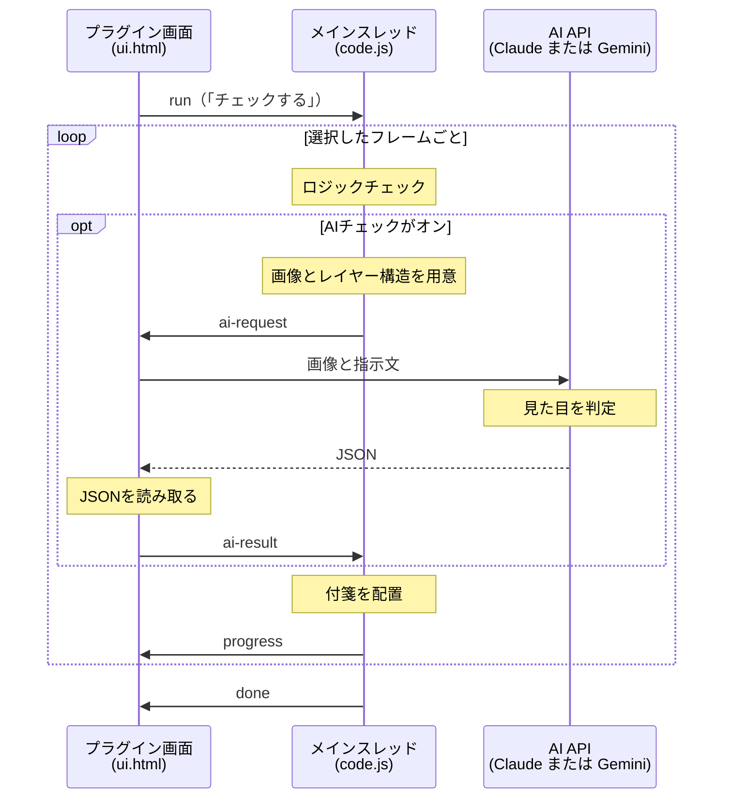

# A11y sticky checker 開発仕様書

Nov 13, 2026 · @Yu Morita

## 概要

A11y sticky checker は、選択したフレームのアクセシビリティを確認し、指摘を付箋風のカードとしてフレームの上か下に貼る Figma プラグインです。本書はバージョン 1.1.1 時点の仕様をまとめたもので、今後の改良の土台として使います。

| 項目 | 内容 |
| --- | --- |
| 対象バージョン | 1.1.1 |
| 対象エディタ | Figma デザイン（FigJam・Dev Mode は対象外） |
| 利用形態 | 開発用プラグインとしてローカルから読み込み（未公開） |
| 実装 | 素の JavaScript。ビルド工程なし |
| AI | Claude API または Gemini API を画面で切り替え |
| WCAG の基準 | WCAG 2.2、主に AA |

チェックは二段構えです。数値で判定できる項目はプログラムが計測し、見た目の解釈が必要な項目だけを AI に任せます。これにより、結果の安定性と API 料金の両方を抑えています。

## ファイル構成

リポジトリ直下に `manifest.json` を置き、クローンしたフォルダをそのまま Figma にインポートできる構成にします。

| ファイル | 役割 |
| --- | --- |
| `manifest.json` | プラグイン名、ID、エントリーファイル、通信を許可するドメインの定義 |
| `code.js` | メインスレッド。レイヤーの読み取り、ロジックチェック、画像の書き出し、付箋の配置 |
| `ui.html` | プラグイン画面。設定の入力、AI API の呼び出し、進捗表示 |
| `README.md` | 読み込み方、使い方、制限 |
| `CHANGELOG.md` | 版ごとの変更記録 |

`manifest.json` の主な設定は次のとおりです。

- `name` は「A11y sticky checker」。バージョンは含めず、版は画面の見出しと Git のタグで管理します。
- `id` は `a11y-sticky-checker-dev`。変えると Figma が別のプラグインとして扱い、保存済みの設定が引き継がれません。
- `api` は Figma Plugin API の版指定で、プラグイン自体のバージョンではありません。
- `documentAccess` は `dynamic-page`。ページ単位で読み込むため、ノード取得などには非同期 API を使います。
- `networkAccess.allowedDomains` は `https://api.anthropic.com` と `https://generativelanguage.googleapis.com` の2つです。

Figma は `ui.html` を1ファイルとして読み込むため、ローカルの別 JS や CSS は参照できません。プロンプトやチェックリストも `ui.html` の中に置きます。

## 処理の流れ

レイヤーの読み書きはメインスレッド（`code.js`）、AI API の呼び出しはプラグイン画面（`ui.html`）が担当し、両者はメッセージでやりとりします。メインスレッドからは外部と通信しない作りにしています。



選択したフレームごとにこの流れを順番に繰り返します。AI チェックがオフのときは、ロジックチェックのあと直接付箋を配置します。

| メッセージ | 向き | 内容 |
| --- | --- | --- |
| `init` | メイン → 画面 | 保存済みの設定 |
| `selection` | メイン → 画面 | 選択中のフレーム数と名前（3件まで） |
| `save-settings` | 画面 → メイン | 保存する設定一式 |
| `run` | 画面 → メイン | 付箋の位置、AI チェックの有無 |
| `ai-request` | メイン → 画面 | 依頼番号、フレーム名、画像、レイヤー構造、検出済みの指摘 |
| `ai-result` | 画面 → メイン | 依頼番号と指摘一覧、またはエラー |
| `progress` | メイン → 画面 | 進捗の文言 |
| `done` | メイン → 画面 | 処理の終了 |
| `clear` | 画面 → メイン | ページ上の付箋をすべて削除 |

チェックの対象は、選択中のフレーム・コンポーネント・インスタンス・コンポーネントセットです。実行中は二重に実行しないよう、メイン側で受け付けを止めます。

## ロジックチェック

プログラムが計測する項目は3つで、同じ内容の指摘は1枚の付箋にまとめ、該当レイヤー名を並べます。

| 項目 | WCAG | 判定基準 | 重要度 | まとめる単位 |
| --- | --- | --- | --- | --- |
| テキストのコントラスト | 1.4.3 AA | 通常 4.5:1 未満、大きい文字は 3:1 未満で指摘 | 要対応 | 文字色・背景色・基準値の組み合わせ |
| 文字サイズ | 1.4.4（参考） | 日本語を含むテキストは 16px 未満、英数字だけなら 14px 未満で指摘 | 推奨 | 言語と文字サイズ |
| タップ領域 | 2.5.8 AA | 幅か高さが 24px 未満で指摘 | 要確認 | レイヤー名とサイズ |

### 走査の方法

- フレームを描画順（親が先、子は配列の先頭から）にたどります。非表示のレイヤーと、累積の不透明度が 0.01 以下のレイヤーは、その子孫ごと対象外です。
- テキストは `getStyledTextSegments` で書式ごとに分け、文字サイズ・塗り・太さを個別に評価します。混在したテキストでも、最も悪いセグメントで判定します。
- 文字サイズは、テキストレイヤーにひらがな・カタカナ・漢字・全角文字が1字でも含まれれば日本語、含まれなければ英数字として基準を選びます。日本語と判定したテキストは、英数字の部分も含めて 16px の基準で判定し、最も小さい文字で指摘します。

### コントラストの計算

- 背景色は、テキストの中心点に重なる塗りを描画順に合成して求めます。何も重ならなければ白とみなします。
- 文字色は、塗りの不透明度とレイヤーの累積不透明度を掛けて背景に合成した色を使います。
- 大きい文字は 24px 以上、または 18.66px 以上かつ太さ 700 以上です。
- 背景に不透明度 0.3 を超える画像やグラデーションがあり、その上を不透明な単色が覆っていない場合は「判定不能」として数え、計算しません。
- 指摘には、文字色を黒か白に向けて 2% ずつ近づけ、基準を 0.05 上回った最初の色を改善案として添えます。

### 操作要素の推定

- 種類がフレーム・インスタンス・コンポーネント・グループで、名前が `button` `btn` `link` `icon` `tab` `toggle` `checkbox` `radio` `switch` `chip` `close` `menu`、または対応する日本語（ボタン、リンク、アイコンなど）を含むものを操作要素とみなします。
- 操作要素と判定したレイヤーの子孫は、重複を避けるため判定しません。
- 名前による推定なので、名前の付け方によって見逃しや誤検出が起こります。

## AIチェック

AI には、計測では判断できない見た目の解釈だけを任せます。画面で「AIによる目視チェックも行う」がオンのときだけ実行します。

| 項目 | Claude | Gemini |
| --- | --- | --- |
| エンドポイント | `https://api.anthropic.com/v1/messages` | `https://generativelanguage.googleapis.com/v1beta/models/{model}:generateContent` |
| 認証ヘッダー | `x-api-key`、`anthropic-version: 2023-06-01`、`anthropic-dangerous-direct-browser-access: true` | `x-goog-api-key` |
| 初期モデル | `claude-sonnet-5-5` | `gemini-3.5-flash` |
| 指示文の渡し方 | `system` | `system_instruction` |
| 出力の指定 | 指示文で JSON のみを要求、`max_tokens` 2000 | `responseMimeType: application/json` |
| 結果の取り出し | `content` のうち `type: text` を連結 | `candidates[0].content.parts` のうち思考部分以外の `text` を連結 |

### 送る内容

- フレームを JPG で書き出した画像。長辺が 1568px 以下になるよう縮小し、拡大は最大 2 倍までです。
- フレーム名。
- 確認する観点。独自チェックリストが空なら既定の7項目を使います。
- ロジックチェックで検出済みの指摘の一覧。AI に重複させないためです。
- レイヤー構造。種類・名前・サイズ・テキスト内容（先頭60文字）を、深さ8まで、最大250行で送ります。

### 既定の観点

1. 1.1.1 意味のある画像やアイコンに代替テキストが必要そうか
2. 1.3.1 見出し・リスト・表などの構造が見た目で明確か
3. 1.3.3／1.4.1 色・形・位置だけで情報を伝えていないか
4. 1.4.11 入力欄の枠線やアイコンなど、テキスト以外の要素のコントラスト
5. 2.4.4／2.5.3 リンクやボタンの文言だけで目的がわかるか
6. 2.4.6／3.3.2 フォームにラベルがあるか
7. 3.3.1 エラー状態をテキストで説明しているか

### 指示文の要点

- コントラスト比・文字サイズ・タップ領域は計測済みなので指摘しない。
- 静的なデザインから判断できる範囲に限り、確信の持てない推測は含めない。
- 重要なものから最大8件。JSON のみで返す。

### 応答の形式

```json
{"issues":[{"title":"20字以内の見出し","wcag":"1.4.1","level":"A","severity":"high","layer":"該当レイヤー名","detail":"80字以内","suggestion":"80字以内"}]}
```

応答はコードブロック記号を取り除き、最初の `{` から最後の `}` までを JSON として読みます。`severity` が想定外の値なら「要確認」に寄せます。API がエラーを返したときは、ロジックチェックの結果だけを貼り、エラー内容を知らせる付箋を添えます。

## 付箋

Figma デザインでは本物の付箋（Sticky）を作れないため、付箋風のフレームを作ってページ直下に置きます。

### 配置

- フレームごとに「A11yチェック｜フレーム名」というまとめ用フレームを1つ作ります。幅はフレームの幅と 560px の大きい方です。
- まとめ用フレームは、見出し（件数と実行日時）と、付箋を横に並べて折り返す行で構成します。付箋の間隔は縦横とも 16px です。
- 位置はフレームの絶対座標を基準に、下なら 48px 下、上なら 48px 上に置きます。フレームがセクションの中にあっても、付箋はページ直下に置きます。
- まとめ用フレームには、対象フレームの ID をプラグインデータ `a11yNoteFor` として記録します。

### 再実行と削除

- 同じフレームを再チェックすると、`a11yNoteFor` が一致する前回の付箋を削除してから貼り直します。
- 「付箋を消す」は、現在のページで `a11yNoteFor` を持つものをすべて削除します。
- 付箋自体を選択して実行しても、チェック対象には含めません。

### 付箋の中身と見た目

付箋は幅 260px、高さは内容に合わせて伸びます。上から、重要度と WCAG 番号（AI 判定ならその旨）、見出し、該当レイヤー名（3件まで、残りは「ほかn件」）、問題の説明、改善案の順に並びます。並び順は 要対応 → 要確認 → 推奨 です。

| 種類 | 色 | 用途 |
| --- | --- | --- |
| 要対応 | #FFD3C7 | 基準を明確に満たしていない |
| 要確認 | #FFE59A | 問題の可能性が高い |
| 推奨 | #FFF5BF | 改善が望ましい |
| OK | #D4F2DA | 指摘が0件 |
| お知らせ | #E2E7EF | 判定不能のテキスト数、AI のエラー |

フォントは Noto Sans JP を優先し、読み込めなければ Inter を使います。絵文字はフォントによって表示されないため使いません。

## 設定と保存

設定はすべて `figma.clientStorage` の `settings` キーに保存され、利用者のパソコンの Figma 内にだけ残ります。入力欄の値が変わるたびに保存します。

| 設定 | 内容 | 初期値 |
| --- | --- | --- |
| `provider` | 使う AI（`claude` / `gemini`） | `claude` |
| `keys` | AI ごとの API キー | 空 |
| `models` | AI ごとのモデル名 | 各 AI の初期モデル |
| `position` | 付箋の位置（`below` / `above`） | `below` |
| `useAI` | AI チェックを行うか | オン |
| `checklist` | 独自チェックリスト（1行1項目） | 空 |

旧形式の `apiKey` と `model` が残っていれば、Claude の設定として引き継ぎます。

### セキュリティ

- API キーはファイルに書かないため、リポジトリに混ざることはありません。動作確認のためにコードへ直接書くことは避けます。
- AI の呼び出しはプラグイン画面からブラウザ経由で直接行います。キーは利用者自身のものを使う前提です。
- 他の人に配布する場合は、キーを中継サーバー側で持つ構成に変える必要があります。

## 制限と今後

### 既知の制限

- 背景色はテキストの中心点だけで判定するため、複数の背景にまたがるテキストは正しく評価できないことがあります。
- 背景に画像やグラデーションがあるテキストは、コントラストを計算しません。
- 塗りの範囲は外接矩形で判定するため、円や角丸の外側にあるテキストを背景の上にあると誤判定することがあります。
- 操作要素はレイヤー名から推定するため、名前次第で見逃しや誤検出が起こります。WCAG 2.5.8 の「間隔による例外」も判定していません。
- 非常に縦長のフレームは画像が縮小され、AI の精度が下がります。
- AI の判定は実行ごとに多少ぶれます。

### 改良候補

- [ ] バージョンを定数にまとめ、画面と付箋の見出しに表示する
- [ ] 付箋から該当レイヤーを選択できるようにする
- [ ] 縦長のフレームを分割して AI に送る
- [ ] 背景色を複数の点で判定する
- [ ] テキスト以外の要素のコントラスト（1.4.11）を計測で判定する

### バージョン管理

バージョンは `ui.html` の見出しに表示し、Git のタグ（`v1.1.1` など）と `CHANGELOG.md` で記録します。`manifest.json` にはプラグイン自体のバージョン欄がないため、名前にも含めません。互換性のない大きな変更は1つ目、機能追加は2つ目、修正は3つ目の数字を上げます。
